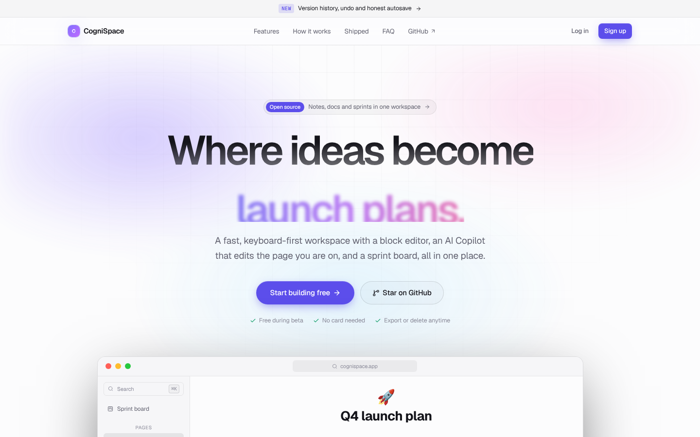
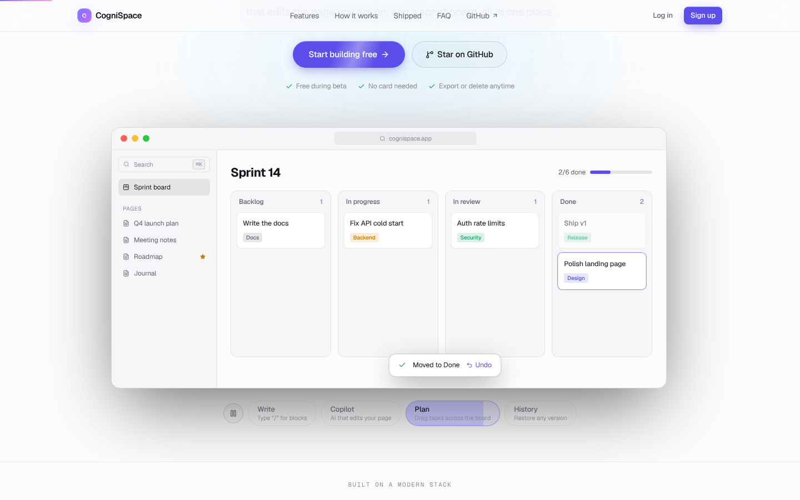

<div align="center">

# CogniSpace

**A fast, keyboard-first workspace for notes, docs and sprints — with an AI Copilot that edits the page you are on.**

[Live demo](https://cognispace-sigma.vercel.app) · [API health](https://cognispace-h5c9.onrender.com/health)

</div>

> The API runs on a free Render instance and sleeps when idle. The first request can take up to ~30 seconds; the app shows a "Waking up the server" banner while it starts.

## Who it is for

Students and small teams who keep notes in one app, tasks in another and paste text into a chatbot in a third tab. CogniSpace keeps pages, a sprint board and an AI Copilot in one place, and the Copilot works on the page you are already on, so nothing needs copying back and forth.

The core promise is trust: your writing is never lost or silently overwritten, and AI text never lands on the page without your review.





## Features

| Area | What you get |
| --- | --- |
| **Home** | Greeting, workspace stats, recent pages, in-flight tasks, first-run checklist |
| **Editor** | TipTap block editor: headings, to-dos, toggles, quotes, code, dividers. `/` menu with keyboard navigation and filtering. Selection toolbar |
| **Copilot** | Gemini streaming over SSE. Improve / summarize a selection, or ask about the open page. Review, insert, undo. Stop button |
| **Sprint board** | Drag-and-drop Kanban + table view, inline editing, sprint progress. Every card also has a status menu, so tasks can be moved with a keyboard or on a phone |
| **Reliability** | Autosave only reports *Saved* after the server confirms. Offline retries with backoff. Optimistic concurrency (version check) with a "load theirs / keep mine" flow |
| **History** | Automatic snapshots (at most one per 2 min, 50 per page). One-click restore that keeps the overwritten text in history |
| **Safety nets** | Undo for page delete and AI inserts. Export a page as HTML, or all data as JSON. Delete account (password-confirmed) |
| **Command palette** | `⌘K` searches page titles and content and runs commands |
| **UX** | Dark / light themes, responsive layout, `prefers-reduced-motion` respected |

Shortcuts: `⌘K` palette · `/` blocks · `⌘J` Copilot · `⌘B` sidebar.

## Architecture

```
React 19 + Vite + Tailwind  ──HTTPS──▶  Express 5 API  ──▶  MongoDB (Mongoose)
 (Vercel)                                (Render)             (Atlas)
   │                                        │
   │  SSE stream                            └──▶ Gemini (@google/genai)
   └────────────────────────────────────────────────▶ /api/ai/transform
```

* **Auth:** bcrypt (cost 12) + JWT (7 days) in an `httpOnly` cookie only. The token is never put in the response body or in `localStorage`, so page scripts cannot read it. On Vercel, `/api` is rewritten to Render, so the cookie is first-party.
* **Documents** carry a `version`. `PATCH` accepts `baseVersion`; a mismatch returns `409` with the current document instead of overwriting.
* **Version history** is a separate `DocumentVersion` collection, trimmed to the 50 newest per page.
* **AI** output is sanitized with an allowlist sanitizer before it is rendered or inserted.
* **Validation:** every write is checked by a zod schema in `server/schemas.js` before it reaches MongoDB; unknown fields are dropped.
* **Pages** can be nested. Deleting a page deletes its sub-pages, and a page cannot be moved under its own child.
* **Rate limits:** global, auth (20 / 15 min) and AI (10 / min and `AI_DAILY_LIMIT` per user per day).

### Design decisions worth knowing

* *Honest autosave.* The earlier version swallowed network errors and still showed "Saved". The sync hook (`src/hooks/useDocSync.ts`) merges pending edits per page, serializes requests, retries with backoff and surfaces conflicts.
* *Production refuses to boot unsafe.* No `JWT_SECRET` or no reachable `MONGODB_URI` in production is a fatal error — never a silent in-memory database.
* *No real-time multiplayer.* Two tabs are detected with version checks, but there is no live co-editing (that would need CRDTs / websockets).

## Getting started

Requires Node 20+.

```bash
npm ci
cp .env.example .env     # optional in development
npm start                # API on :3001 (embedded in-memory MongoDB when MONGODB_URI is empty)
npm run dev              # Vite on :5173 (proxies /api to :3001)
npm test                 # API tests against an embedded MongoDB
npm run build && npm run test:e2e   # browser journey: sign up, write, reload, board, palette, log out
```

CI (`.github/workflows/ci.yml`) runs lint, type check and build, the API tests and the browser journey on every push and pull request.

| Variable | Required in prod | Purpose |
| --- | --- | --- |
| `JWT_SECRET` | yes | Signs session tokens (`render.yaml` generates one) |
| `MONGODB_URI` | yes | MongoDB Atlas connection string |
| `CORS_ORIGINS` | yes | Comma-separated browser origins, e.g. your Vercel URL |
| `GEMINI_API_KEY` | for AI | Copilot. Without it production returns a clear error |
| `GEMINI_MODEL` | no | Defaults to `gemini-3.8-flash` |
| `GEMINI_FALLBACK_MODEL` | no | Tried if the main model keeps answering 503 or 429 (each model gets 3 attempts) |
| `AI_DAILY_LIMIT` | no | Per-user AI requests per day (default 60) |

## Deploy

* **API → Render:** `render.yaml` builds with `npm ci --omit=dev` and starts `node server/server.js`. Set `MONGODB_URI`, `GEMINI_API_KEY` and `CORS_ORIGINS` in the dashboard.
* **Web → Vercel:** framework preset *Vite*; `vercel.json` already rewrites `/api/*` to the Render service.

## Project layout

```
src/
  components/app/      Workspace shell, Home, Sidebar, Page, Sprint board, Copilot, Palette, Settings, History
  components/editor/   TipTap editor + slash menu
  components/landing/  Landing illustrations
  hooks/               useDocSync (autosave), useWorkspace (data), useCopilot, useTheme, useOnboarding
  utils/               sanitize, aiStream (SSE), api
server/
  server.js            Boot: connect the database, listen, shut down cleanly
  app.js               createApp(): middleware and routes, no I/O (what the tests use)
  config.js            Environment, secrets, cookie and limit settings
  db.js                MongoDB connection (embedded database in development only)
  schemas.js           zod request schemas for every write
  routes/              auth, documents (versions, conflicts), tasks
  middleware/          auth, validation, CORS and security headers, rate limits, errors
  services/            starter data, version snapshots
  controllers/         aiController (Gemini streaming with retries and fallback)
  models/              User, Document, DocumentVersion, Task
  app.test.js          API tests: auth, privacy, 409 conflicts, validation, tasks, account deletion
```

## Known limitations

* No real-time co-editing; two tabs on the same page are detected with version checks (409) and you choose which text to keep.
* No shared workspaces: every page belongs to one account.
* The free Render instance sleeps, so the first request after a while is slow.
* The Copilot depends on Google's Gemini API. When Gemini is overloaded, the server retries, then tries `GEMINI_FALLBACK_MODEL` if set, then shows an error.
* No error monitoring service is wired in yet; errors are logged to the Render console.

## Roadmap

* [x] API integration tests in CI
* [ ] `useDocSync` unit tests and a Playwright smoke test
* [ ] Shared workspaces and page sharing
* [ ] Real-time co-editing
* [ ] Per-user AI usage dashboard

## License

MIT © Karthik Uppari
