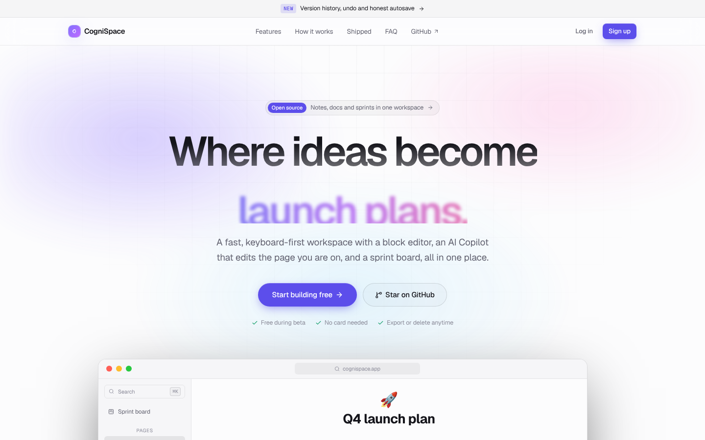
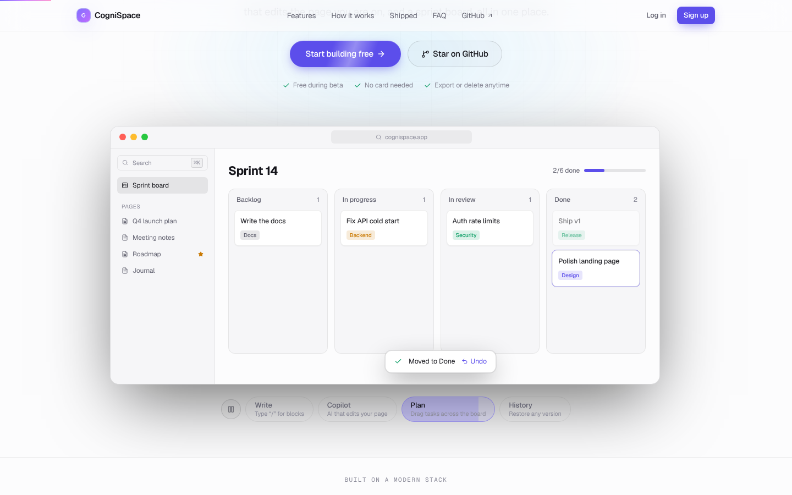

<div align="center">

# CogniSpace

**Your notes, turned into tracked tasks and answers.** A fast workspace with a block editor, a sprint board and an AI Copilot that finds the action items in your notes and answers questions across every page, with sources.

[Live demo](https://cognispace-sigma.vercel.app) · [API health](https://cognispace-h5c9.onrender.com/health)

</div>

> The API runs on a free Render instance and sleeps when idle. The first request can take up to ~30 seconds; the app shows a "Waking up the server" banner while it starts.

## The problem

Teams decide things in their notes, then lose them. A meeting ends with "Priya will redesign onboarding by Friday", but that line never reaches the task board, and a week later nobody can find what was agreed or where.

Notes apps hold the words, task boards hold the work, and a chatbot in a third tab knows neither. CogniSpace connects them:

1. **Notes → tasks.** Copilot reads a page and finds the action items, including who and by when. You tick the ones you want and they land on the sprint board, each linked back to the page it came from.
2. **Ask your workspace.** Ask "When is the beta launch?" and get an answer drawn from all your pages, with numbered sources you can click. If nothing in your notes answers it, it says so instead of guessing.

It is built for students and small teams, and it is built to be trusted: your writing is never lost or silently overwritten, and AI text never lands on a page without your review.





## Features

| Area | What you get |
| --- | --- |
| **Home** | Greeting, workspace stats, recent pages, in-flight tasks, first-run checklist |
| **Editor** | TipTap block editor: headings, to-dos, toggles, quotes, code, dividers. `/` menu with keyboard navigation and filtering. Selection toolbar |
| **Notes → tasks** | "Create tasks" on any page finds its action items: open to-dos (always, no AI needed, with the owner and deadline read from the line) plus items Gemini finds in the prose. Review and edit them, then add them to the Backlog. Cards link back to the page; the page shows how many of its tasks are on the board; items already added are marked |
| **Ask your workspace** | Questions across every page. BM25 search over page passages picks the sources, then Gemini answers only from them with `[1]` citations that open the page. No match means no AI call and an honest "I couldn't find that". Without AI it still shows the best matching lines |
| **Copilot** | Gemini streaming over SSE. Improve / summarize a selection, or ask about the open page. Review, insert, undo. Stop button. Fails fast with a clear reason and falls back to a lighter model; `GET /api/ai/status` shows whether it works |
| **Sprint board** | Drag-and-drop Kanban + table view, inline editing, sprint progress. Every card also has a status menu, so tasks can be moved with a keyboard or on a phone |
| **Reliability** | Autosave only reports *Saved* after the server confirms. Offline retries with backoff. Optimistic concurrency (version check) with a "load theirs / keep mine" flow |
| **History** | Automatic snapshots (at most one per 2 min, 50 per page). One-click restore that keeps the overwritten text in history |
| **Safety nets** | Undo for page delete and AI inserts. Export a page as HTML, or all data as JSON. Delete account (password-confirmed) |
| **Sharing** | Publish any page as a read-only link (`/s/<id>`); the link shows only the page, never your other pages or your account. Stop sharing at any time and the old link stops working |
| **Account security** | Password reset by email (30-minute single-use link). A reset signs out every other session. Repeated wrong passwords lock that email for 15 minutes, tracked in MongoDB so it survives restarts |
| **Command palette** | `⌘K` searches page titles and content and runs commands |
| **UX** | Dark / light themes, responsive layout, `prefers-reduced-motion` respected |

Shortcuts: `⌘K` palette · `/` blocks · `⌘J` Copilot · `⌘B` sidebar.

## Architecture

```
React 19 + Vite + Tailwind  ──HTTPS──▶  Express 5 API  ──▶  MongoDB (Mongoose)
 (Vercel)                                (Render)             (Atlas)
   │                                        │
   │  SSE stream                            └──▶ Gemini (@google/genai)
   └────────────────────────────────────────────────▶ /api/ai/transform
```

* **Auth:** bcrypt (cost 12) + JWT (7 days) in an `httpOnly` cookie only. The token is never put in the response body or in `localStorage`, so page scripts cannot read it. On Vercel, `/api` is rewritten to Render, so the cookie is first-party.
* **Documents** carry a `version`. `PATCH` accepts `baseVersion`; a mismatch returns `409` with the current document instead of overwriting.
* **Version history** is a separate `DocumentVersion` collection, trimmed to the 50 newest per page.
* **AI** output is sanitized with an allowlist sanitizer before it is rendered or inserted.
* **Ask your workspace** splits each page into passages under their headings, ranks them with BM25 (title and heading count as part of the passage, at most two passages per page), and only calls Gemini when the best passage covers at least half of the question's words. Sources are sent first over SSE, then the answer.
* **Notes → tasks** asks Gemini for JSON that matches a schema (title, assignee, due, priority) and merges it with the page's unchecked to-dos, dropping near-duplicates. Creating tasks checks that the page is yours; each task stores the page id.
* **Validation:** every write is checked by a zod schema in `server/schemas.js` before it reaches MongoDB; unknown fields are dropped.
* **Pages** can be nested. Deleting a page deletes its sub-pages, and a page cannot be moved under its own child.
* **Rate limits:** global, auth (20 / 15 min) and AI (10 / min and `AI_DAILY_LIMIT` per user per day).

### Design decisions worth knowing

* *Honest autosave.* The earlier version swallowed network errors and still showed "Saved". The sync hook (`src/hooks/useDocSync.ts`) merges pending edits per page, serializes requests, retries with backoff and surfaces conflicts.
* *Production refuses to boot unsafe.* No `JWT_SECRET` or no reachable `MONGODB_URI` in production is a fatal error — never a silent in-memory database.
* *No real-time multiplayer.* Two tabs are detected with version checks, but there is no live co-editing (that would need CRDTs / websockets).

## Getting started

Requires Node 20+.

```bash
npm ci
cp .env.example .env     # optional in development
npm start                # API on :3001 (embedded in-memory MongoDB when MONGODB_URI is empty)
npm run dev              # Vite on :5173 (proxies /api to :3001)
npm test                 # API tests against an embedded MongoDB
npm run build && npm run test:e2e   # browser journey: sign up, write, reload, board, palette, log out
```

CI (`.github/workflows/ci.yml`) runs lint, type check and build, the API tests and the browser journey on every push and pull request.

| Variable | Required in prod | Purpose |
| --- | --- | --- |
| `JWT_SECRET` | yes | Signs session tokens (`render.yaml` generates one) |
| `MONGODB_URI` | yes | MongoDB Atlas connection string |
| `CORS_ORIGINS` | yes | Comma-separated browser origins, e.g. your Vercel URL |
| `GEMINI_API_KEY` | for AI | Copilot. Without it production returns a clear error |
| `GEMINI_MODEL` | no | Defaults to `gemini-3.8-flash` |
| `GEMINI_FALLBACK_MODEL` | no | Tried if the main model keeps answering 503 or 429 (each model gets 3 attempts) |
| `AI_DAILY_LIMIT` | no | Per-user AI requests per day (default 60) |

## Deploy

* **API → Render:** `render.yaml` builds with `npm ci --omit=dev` and starts `node server/server.js`. Set `MONGODB_URI`, `GEMINI_API_KEY` and `CORS_ORIGINS` in the dashboard. For password-reset email, also set `RESEND_API_KEY`, `EMAIL_FROM` (a sender on a domain verified in Resend) and `APP_URL`.
* **Web → Vercel:** framework preset *Vite*; `vercel.json` already rewrites `/api/*` to the Render service.

## Project layout

A request goes through the same layers every time, and each layer only talks to the one below it:

```
request -> middleware (security, CORS, rate limit, auth, validation) -> routes -> controllers -> services -> models -> MongoDB
```

```
src/                              React 19 + TypeScript (Vite)
  App.tsx                         Picks the landing page, auth, reset, shared page or the workspace
  pages/                          LandingPage, AuthPage, ResetPasswordPage, SharedPage
  components/app/                 Workspace shell, Home, Sidebar, Page, Sprint board, Copilot, Palette, Settings, History, Share
  components/editor/              TipTap editor + slash menu
  components/landing/             Landing sections and illustrations
  components/ui/                  Popover, motion helpers
  hooks/                          useWorkspace (data), useDocSync (autosave + conflicts), useCopilot, useTheme, useOnboarding
  lib/types.ts                    Shared front-end types (Doc, Task, User)
  utils/                          api, aiStream (SSE reader), sanitize
server/
  server.js                       Boot: connect the database, listen, shut down cleanly
  app.js                          createApp(): middleware and /api, no I/O (what the tests use)
  config.js                       Environment, secrets, cookie and limit settings
  db.js                           MongoDB connection (embedded database in development only)
  schemas.js                      zod request schemas for every write
  routes/                         URL + middleware -> controller, nothing else
    index.js                      Mounts every router under /api (public share links first)
    auth.js, documents.js, tasks.js, share.js, ai.js
  controllers/                    HTTP only: read the request, call a service, set cookies and status codes
    auth.controller.js, document.controller.js, task.controller.js, ai.controller.js (Gemini SSE streaming)
  services/                       Rules and database work; no req/res; throw HttpError
    auth.service.js               Sign-up, credentials, password reset, account deletion, export
    document.service.js           Pages: tree moves, 409 version conflicts, history, restore, sharing, cascade delete
    task.service.js               Sprint-board tasks
    pageTasks.service.js          Notes -> tasks: find action items on a page, create linked tasks
    workspaceAsk.service.js       Ask your workspace: passages, BM25 search, cited answer
    ai.service.js                 Gemini calls: timeouts, fallback model, JSON output, status check
    versions.js, seed.js, email.js
  middleware/                     auth (JWT + session version), validate (zod, ids), loginLockout, rateLimits, security, errors
  lib/httpError.js                HttpError with a status; errors.js turns it into JSON
  lib/pageText.js                 Page HTML -> headings, paragraphs and to-dos
  models/                         User, Document, DocumentVersion, Task, LoginAttempt
  tests/                          api.test.js (API against an in-memory MongoDB), ai.test.js (Gemini handling), workspace.test.js (tasks + search)
e2e/                              Browser journeys (Playwright)
```

### Where to change things

| You want to... | Change |
| --- | --- |
| Add an API endpoint | Route in `server/routes/`, handler in `controllers/`, logic in `services/` |
| Validate a new field | `server/schemas.js` (zod), then the model in `server/models/` |
| Change a rule (who can see what, limits, conflicts) | `server/services/` |
| Change the Copilot prompt or model behaviour | `server/controllers/ai.controller.js`, `server/services/ai.service.js` |
| Change how action items or answers are found | `server/services/pageTasks.service.js`, `server/services/workspaceAsk.service.js` |
| Change the AI cost limits | `server/middleware/rateLimits.js` and `AI_DAILY_LIMIT` |
| Change what the editor saves or when | `src/hooks/useDocSync.ts` |
| Change workspace data loading | `src/hooks/useWorkspace.ts` |

## Known limitations

* No real-time co-editing; two tabs on the same page are detected with version checks (409) and you choose which text to keep.
* No shared workspaces: every page belongs to one account. Pages can be shared read-only by link, not edited together.
* Password-reset email needs a Resend account and a verified sender domain; without it, reset links only appear in the server log.
* The free Render instance sleeps, so the first request after a while is slow.
* The Copilot depends on Google's Gemini API. When Gemini is slow or overloaded, the server retries, then uses `GEMINI_FALLBACK_MODEL`, then shows a clear error. Notes → tasks and Ask still work without it, using to-dos and keyword search.
* Ask your workspace uses keyword search (BM25), so it matches words, not meaning: "launch date" finds "launch", but not "release". Embeddings would fix that.
* No error monitoring service is wired in yet; errors are logged to the Render console.

## Roadmap

* [x] API integration tests in CI
* [x] Playwright journey test
* [x] Read-only page sharing
* [x] Password reset and persistent login lockout
* [x] Notes → tasks with links back to the page
* [x] Ask your workspace with cited sources
* [ ] Semantic search (embeddings) for Ask your workspace
* [ ] `useDocSync` unit tests
* [ ] Shared workspaces
* [ ] Real-time co-editing
* [ ] Per-user AI usage dashboard

## License

MIT © Karthik Uppari
